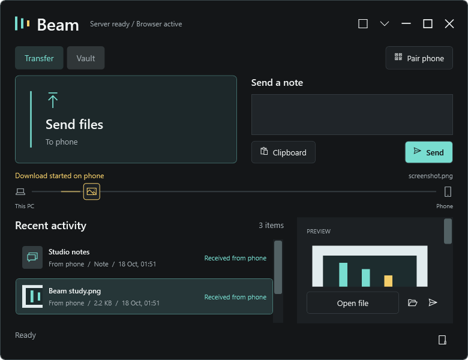
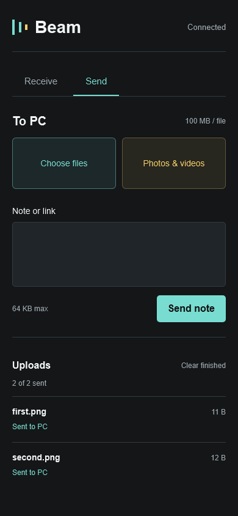
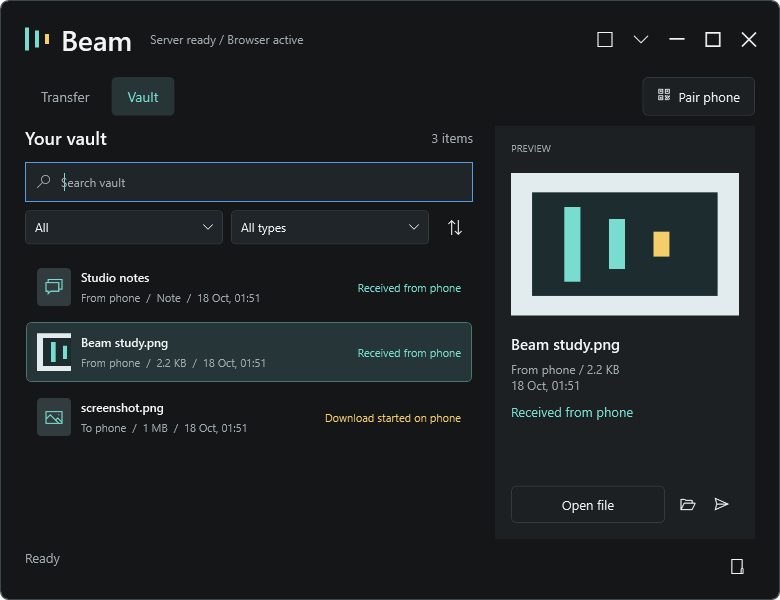

# Beam

**Files and notes between your Windows PC and iPhone, over your local network.**

Beam is a Windows desktop app with an embedded HTTP server and a two-way phone
browser interface. iOS Shortcuts is optional, not required. No cloud relay or
Beam account is required for transfers. Both devices need to reach the same PC
on the local network.

> Development build. Core transfers have been tested on a real iPhone, but this
> is not a hardened internet-facing service or an encrypted storage product.



Screenshots use generated demo files and notes, not personal transfers.

### Safari First

Scan the PC's QR, then use **Send** and **Receive** in Safari. No Shortcut is
required for files, photos, videos, notes or links.

[Download the Windows x64 alpha](https://github.com/IlhamSay123/beam/releases/tag/v0.1.0-alpha.1).
Extract the whole ZIP, open Beam.App.exe, and follow START-HERE.txt. No SDK or
.NET installation is required. This remains an unsigned trusted-LAN alpha.



## What Works

| Area | Current functionality |
| --- | --- |
| PC to phone | Queue files, typed notes, and clipboard text. Download files or copy notes from the phone browser. |
| Phone to PC | Choose photos/videos/files or send notes/URLs directly in Safari, with per-item upload progress, cancel and retry. An iOS Shortcut remains optional. |
| Multiple photos | Select several in Safari and upload sequentially with original filenames. The older optional Shortcut's six-photo flow was verified on a real iPhone; the new browser flow still needs an iPhone acceptance test. |
| Desktop workspace | Resizable Transfer and Vault views, file picker, drag-and-drop, queue feedback, and arrival animations. |
| Compact widget | Draggable, always-on-top 164 x 48 pill with status feedback, file drops, expansion, and a context menu. |
| Vault | Search filenames and note contents, filter direction/type, sort by date, preview images/notes, open, reveal, copy, and resend. |
| Pairing | QR browser pairing, local IP fallback, and copyable token/link. |
| Persistence | Inbox, outbox, notes, and acknowledgement state survive app restarts. Records no longer expire automatically. |
| Error handling | Missing files, invalid tokens, network failures, empty uploads, and failed acknowledgements are surfaced. |

### Window Controls

- **Pill mode:** keeps a compact widget visible on your desktop. Click to expand;
  drag to move; drop files to queue them.
- **Minimize:** normal Windows taskbar minimization. Receiving continues.
- **Hide to tray:** hides the window while keeping the receiver active.
- **Close / Quit Beam:** finishes an active desktop queue operation, disposes the
  tray icon, and stops the HTTP server. Closing does not silently leave Beam running.


## Requirements

- Windows 10/11 for the WPF desktop app.
- .NET 8 SDK to build and run from source; the self-contained ZIP needs no .NET installation.
- An iPhone with Safari or another browser. No App Store installation or Shortcut is needed.
- A local network that allows the phone to connect to the PC on TCP port `8787`.
- Node.js 22+ and Microsoft Edge for the browser test suite, or another installed
  Playwright Chromium channel selected with `BEAM_BROWSER`.

The desktop application is Windows-only. The browser inbox uses standard HTML,
CSS, and JavaScript. There is no native iOS app or ready-made Shortcut installer.

## Build and Run

From the repository root in PowerShell:

```powershell
dotnet restore Beam.sln
dotnet build Beam.sln
dotnet run --project src/Beam.App/Beam.App.csproj
```

Run **Beam.App**, not Beam.Server directly: the desktop app configures the real
server endpoints, token, storage, and network advertisement. The server project's
standalone `Program.cs` is currently only a placeholder host.

The desktop workspace opens and the embedded server listens on all interfaces
at port `8787`. Check the browser inbox on the PC at:

```text
http://localhost:8787/app/
```

For a portable build folder containing the .NET runtime:

```powershell
dotnet publish src/Beam.App/Beam.App.csproj `
  --configuration Release --runtime win-x64 --self-contained true `
  --output artifacts/publish/win-x64
```

Keep the complete publish folder together; it includes the browser assets and
dependencies. An installer, code signing and auto-updating are not provided yet.

## Connect an iPhone

1. Start Beam on the PC. Put both devices on a reachable local network.
2. Open **Pair phone** in the desktop workspace or tray menu.
3. Scan the QR code with the phone. The link pairs the browser with the PC token.
4. If the hostname does not resolve, use the PC's Wi-Fi IPv4 address:
   `http://<PC-IP>:8787/app/`. The pairing screen displays a local address.
5. If pairing manually, enter the PC token shown in Beam.
6. Queue a note or file on the PC. On the phone, use **Copy**, or tap
   **Download** and then **Save** for a file.

Allow Beam through the Windows firewall on your trusted private network if
prompted. Do not disable the firewall globally. Guest networks, extender client
isolation, and router isolation can prevent devices from reaching each other
even when their Wi-Fi names look similar.

To send from the phone, open **Send**, choose files/photos, or enter a note/link.
See the [Safari guide](docs/setup/safari-setup.md). The
[Share Sheet Shortcut](docs/setup/ios-shortcut-setup.md) is an optional convenience.

### Windows Alpha Package

```powershell
./scripts/Publish-Beam.ps1
```

This produces a versioned, self-contained win-x64 ZIP and SHA-256 checksum under
artifacts/release, including START-HERE.txt. The Package Windows Alpha workflow
can build the same downloadable artifact in GitHub Actions. It is unsigned and
remains a trusted-LAN alpha, not a signed installer or hardened public service.

### Shortcut Request Summary

Both branches POST to `http://<PC-IP>:8787/receive` with:

```text
Header name:  X-Beam-Token
Header value: <token from Beam's pairing screen>
```

| Input | Request Body | Value |
| --- | --- | --- |
| Note or URL | Form | A Text field named `text`, set to Shortcut Input |
| One file/photo | File | Shortcut Input |
| Multiple files/photos | File, inside Repeat with Each | Repeat Item |

Let Shortcuts generate Content-Type. Direct File bodies and multipart Form file
fields are different formats; Beam accepts both, but the Repeat with Each direct
file workflow is the verified multi-photo setup. Direct uploads receive generated
filenames because this Shortcut does not send original filename metadata.

## The Vault



Beam stores its data under the current Windows user's Documents folder:

```text
Documents/Beam/
  Inbox/         Received files
  Outbox/        Copies of queued/sent files
  history.json   Transfer metadata, note contents, and acknowledgement state
  token.txt      Shared pairing secret
```

- Notes live in the history index; files live in Inbox/Outbox.
- Sending a file queues a copy rather than moving the original.
- Files manually removed outside Beam are labelled missing in the vault.
- New history records are retained rather than automatically capped at 50 items
  or seven days. Previously pruned records are not reconstructed automatically.
- History saves replace a completed temporary file, and desktop Quit waits for
  active queue work to finish.
- There is no storage quota, encrypted vault, recycle bin, or automatic cleanup UI.

**Queued** means waiting for the phone to acknowledge. **Delivered** means the
browser acknowledged the copy/download action; it cannot prove that a user
finished saving a file permanently. **LAN ready** describes the PC server, not
a verified live phone connection.

## Architecture

```text
iPhone Share Sheet / Shortcuts
        | authenticated HTTP POST
        v
Windows WPF app -- embedded ASP.NET Core server -- Inbox + history.json
        |
        +-- Transfer workspace / Vault / compact pill / tray
        |
        +-- Outbox queue <-- phone browser polls, downloads, acknowledges
```

| Path | Purpose |
| --- | --- |
| `src/Beam.App/` | WPF desktop host, tray lifecycle, pill, vault, previews, and QR pairing |
| `src/Beam.Server/` | Embedded ASP.NET Core endpoints, token middleware, storage, and queue |
| `src/Beam.Server/wwwroot/` | Phone browser inbox; no frontend build step |
| `tests/Beam.Server.Tests/` | Backend unit/integration tests |
| `tests/Beam.App.Smoke/` | Windows desktop smoke harness with isolated data and a random port |
| `tests/Beam.Web.Tests/` | Chromium/WebKit browser regressions and real-server integration tests |
| `tests/Beam.Web.Host/` | Isolated real server fixture for browser integration tests |
| `docs/setup/` | Current setup, desktop behavior, and verification guides |
| `docs/superpowers/` | Historical design/implementation notes; some describe earlier behavior |

### HTTP API

All data endpoints require `X-Beam-Token`. The root and browser static assets
are public so a phone can load the pairing UI without already knowing the token.

| Method | Route | Behavior |
| --- | --- | --- |
| GET | `/` | Redirect to `/app/`; does not disclose the PC token |
| GET | `/app/` | Phone inbox and pairing UI |
| POST | `/receive` | Save multipart files/`text`, or a direct file body; return created IDs |
| GET | `/capabilities` | Authenticated file/note upload limits |
| GET | `/outbox` | List unread outbound items |
| GET | `/outbox/{id}/content` | Stream stored file bytes |
| POST | `/outbox/{id}/ack` | Persist acknowledgement |

Successful uploads return `{"ids":["<item-id>"]}`. An invalid token returns
`401`; an empty form or empty direct upload returns `400`. A filename extension
is inferred for common direct-upload media types; unknown types use `.bin`.
The outbox is polled approximately every four seconds; desktop history refreshes
approximately every two seconds.

## Tests

```powershell
# Backend
dotnet test tests/Beam.Server.Tests/Beam.Server.Tests.csproj

# Native desktop harness (Windows)
dotnet run --project tests/Beam.App.Smoke/Beam.App.Smoke.csproj

# Phone browser regression tests (Edge must be installed)
dotnet build tests/Beam.Web.Host/Beam.Web.Host.csproj --configuration Release
Push-Location tests/Beam.Web.Tests
npm ci
npm test
# Safari-family engine (not a real iPhone)
npx playwright install webkit
$env:BEAM_ENGINE = "webkit"
npm test
Remove-Item Env:BEAM_ENGINE
Pop-Location
```

The desktop harness covers exact file bytes, dispatcher responsiveness, search,
filters, sorting, previews, resend, missing files, resizing, pill mode, minimize,
hide/reopen, and quitting from window/tray during a pending save. It checks that
the tray icon is disposed, history survives, and the server port is released.

The browser tests exercise the real HTML/CSS/JavaScript with fixture HTTP
responses and an isolated real ASP.NET Core host, including plain-HTTP clipboard fallback, direct-tap download saving,
invalid-token recovery, network/acknowledgement failures, responsive layouts,
download timeouts, polling races, browser uploads, original names/bytes, progress
states, cancellation and retry. WebKit is Safari-family engine coverage, not
automation of a physical iPhone.

GitHub Actions builds the Windows solution and runs backend/browser checks.
Native tray/desktop smoke tests remain a local Windows check. Read the
[verification guide](docs/setup/verification.md) before treating a build as a release.

## Security and Limits

- **Trusted LAN only.** The server binds to all interfaces on port `8787`.
  Do not port-forward it or expose it directly to the internet.
- HTTP traffic and stored files/notes are not encrypted by Beam.
- The pairing token is a shared bearer secret, stored in plain text on the PC
  and in browser local storage. QR pairing links also contain it.
- Anyone with network access and the token can use the protected endpoints.
  There is no per-device identity, expiry, device-revocation UI, or rate limiting.
- Default uploads are capped at 100 MiB per file and notes at 64 KiB UTF-8;
  uploads are not resumable. Queues do not survive page reloads. Unconfirmed
  retries can create duplicates. Keep Safari open during a transfer.
- Phone downloads are prepared in browser memory and constrained by available memory.
- Windows image codec availability affects previews, especially HEIC/WebP.
- Folder transfers, mixed-DPI multi-monitor behavior, and all iOS versions have
  not been fully verified.
- Keep the token, transferred files, personal history, and diagnostic logs out
  of Git. See [SECURITY.md](SECURITY.md).

## Next Improvements

- Original filename metadata for the optional Shortcut (Safari already preserves its picker filenames).
- Migrate from .NET 8 before its end of support; this milestone still targets .NET 8.
- Real byte progress, cancellation, retries, and resumable large transfers.
- Favorites/pinning and optional storage cleanup controls.
- Better network diagnostics and device connection visibility.
- Encrypted transport, token rotation, and device-specific authorization.
- Signed installer, Windows startup integration, and release packaging.

## Project Status and License

Beam is a private development project. Core transfers have been tested in both
directions on a physical iPhone, including multi-photo sending. Automated checks
are useful regression coverage, not a substitute for release testing.

No open-source license has been selected or included. The repository is not
being published as an open-source release.
