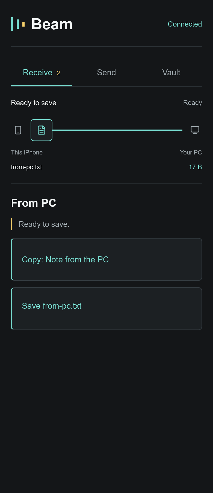
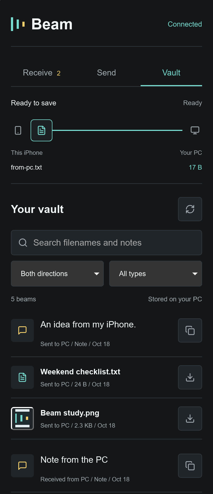
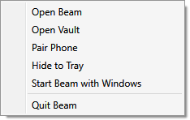

# Beam

**Files, photos and notes between your Windows PC and iPhone, over your local network.**

[Download alpha.3](https://github.com/IlhamSay123/beam/releases/tag/v0.1.0-alpha.3) · [Windows guide](docs/setup/desktop.md) · [iPhone guide](docs/setup/safari-setup.md) · [Architecture](docs/development/architecture.md)

Beam combines a Windows desktop app with a phone interface you open in Safari.
No phone app, Shortcut, cloud relay or Beam account is required for the normal
workflow. Both devices need to reach the same PC on the local network.

## Why I built Beam

I constantly transfer files between my PC and iPhone, so I made Beam for personal
use. I took that everyday need as a fun challenge: build a tool I would actually
use, and see how far I could take it.

That grew into a desktop workspace, a browser interface for the phone, a
searchable Vault, safer transfer retries, pairing controls and a Windows installer.
It is still a personal project and an unsigned alpha, with the limitations below.

## Download and get started

**Windows 10/11, x64.** The runtime is bundled; no SDK or separate .NET installation is needed.

- [Windows installer](https://github.com/IlhamSay123/beam/releases/download/v0.1.0-alpha.3/Beam-0.1.0-alpha.3-win-x64-Setup.exe) — per-user installation, Start menu shortcut and optional Windows startup.
- [Portable ZIP](https://github.com/IlhamSay123/beam/releases/download/v0.1.0-alpha.3/Beam-0.1.0-alpha.3-win-x64.zip) — extract the complete folder and keep its files together.
- [Release notes and SHA-256 checksums](https://github.com/IlhamSay123/beam/releases/tag/v0.1.0-alpha.3).

1. Quit an older Beam instance, then run Setup or open the extracted `Beam.App.exe`.
2. Put the PC and iPhone on a reachable local network. Allow Beam on your trusted
   private network if Windows prompts.
3. Open **Pair phone**, select the appropriate PC address and scan the QR with
   the iPhone camera.
4. In Safari, use **Send**, **Receive** and **Vault**.

Existing Vault files, history and pairing are reused when upgrading.
**Start Beam with Windows** is optional and off for new installations. Automatic
sign-in launches stay in the tray. You can change the option from the tray or pill menu.

## The phone interface

| Send to PC | Receive from PC | Your Vault |
| :---: | :---: | :---: |
|  |  |  |

All screenshots use generated files and notes. Desktop captures render the actual
WPF interface; phone captures use the actual browser interface in WebKit at a
390-pixel viewport. They are not photographs of a physical iPhone.
[Capture details and reproduction commands](docs/assets/README.md).

More desktop views: Vault, compact pill and Windows startup

### Desktop Vault

Search files and note contents, filter by direction/type, preview images and
reuse earlier transfers.

### Compact pill

A small draggable widget for activity, file drops and opening the workspace.

### Windows startup

Right-click the pill or open the tray menu to change **Start Beam with Windows**.

## What Beam does

| Area | Current behaviour |
| --- | --- |
| PC → iPhone | Queue files, typed notes or clipboard text; copy notes and save files in the phone browser. |
| iPhone → PC | Send selected photos, videos, files, notes and links through Safari, with individual progress, cancel and retry. |
| Vault | Retain transfers in both directions with search, filters, previews and repeat copy/download; desktop adds sorting, open, reveal and resend. |
| Safer retries | Check the saved receipt and reuse the original upload ID to avoid creating another item when retrying the same browser job. |
| Pairing | QR/manual pairing, address selection, local checks, redacted diagnostics and confirmed reset/token rotation. |
| Desktop | Resizable workspace, drag-and-drop, compact pill, taskbar minimization and hide-to-tray. |
| Installation | Per-user Setup, portable ZIP, optional desktop shortcut, optional tray startup and uninstall that preserves Documents/Beam. |
| Connection feedback | Recent authenticated browser activity on Windows and retry/foreground recovery in Safari. |

**Queued**, **acknowledged** and **permanently saved on the phone** are different
states. A started download cannot prove that someone completed the phone's Save action.
Close or **Quit Beam** stops the app; **Hide to tray** keeps receiving active.

## Security and current limits

- **Trusted local networks only.** Beam uses HTTP, listens on port `8787` and
  does not encrypt transfers or stored files. Do not expose it to the internet.
- Pairing uses a shared bearer token stored on the PC and in the browser.
  Reset pairing revokes all paired browsers together; there is no individual
  device revocation or automatic expiry.
- The Windows app and installer are unsigned. Updates are installed manually.
- Upload limits are **100 MiB per file** and **64 KiB UTF-8 per note**.
  Uploads do not resume from partial bytes.
- Keep Safari open. Retry the existing upload row: reloading, clearing it or
  selecting the file again loses that job's retry identity.
- Phone downloads use browser memory. Router isolation, firewall settings and
  PC address changes can affect connectivity.
- Storage is local JSON plus files. Recovery after abrupt power/disk loss and
  every Windows/iOS configuration are not guaranteed.

Read [SECURITY.md](SECURITY.md) before sharing tokens, screenshots or diagnostics.

## How it is built

- **Desktop:** C#/.NET 10 and WPF.
- **Server:** embedded ASP.NET Core, authenticated HTTP endpoints and local storage.
- **Phone:** HTML, CSS and JavaScript with no frontend build step.
- **Packaging:** self-contained Windows x64 builds and a per-user Inno Setup installer.
- **Checks:** xUnit, Chromium/WebKit browser tests, native desktop smoke and
  isolated install/upgrade/uninstall tests in GitHub Actions.

Alpha.3 verification includes 199 backend checks, 93 checks in each browser
engine, the full local native smoke harness, and user-reported iPhone transfer/
re-pairing and Windows startup acceptance. Automated WebKit tests do not replace
physical iPhone testing.

[Build and test instructions](CONTRIBUTING.md) · [Architecture and API](docs/development/architecture.md) · [Verification and manual checks](docs/setup/verification.md)

## Ideas for future improvements

- Recoverable storage, consistent save/rollback behaviour and stronger history recovery.
- Encrypted transport and pairing with individual device controls.
- Durable phone queues and resumable large transfers.
- Vault storage controls, favourites and faster everyday sending.
- Code signing and easier update delivery.

These are areas to explore; they are not features of alpha.3.

## Project status and licence

Beam is a personal project shared publicly. No project licence has been selected yet.
The icon library's own licence is included at `src/Beam.Server/wwwroot/lucide.LICENSE`.